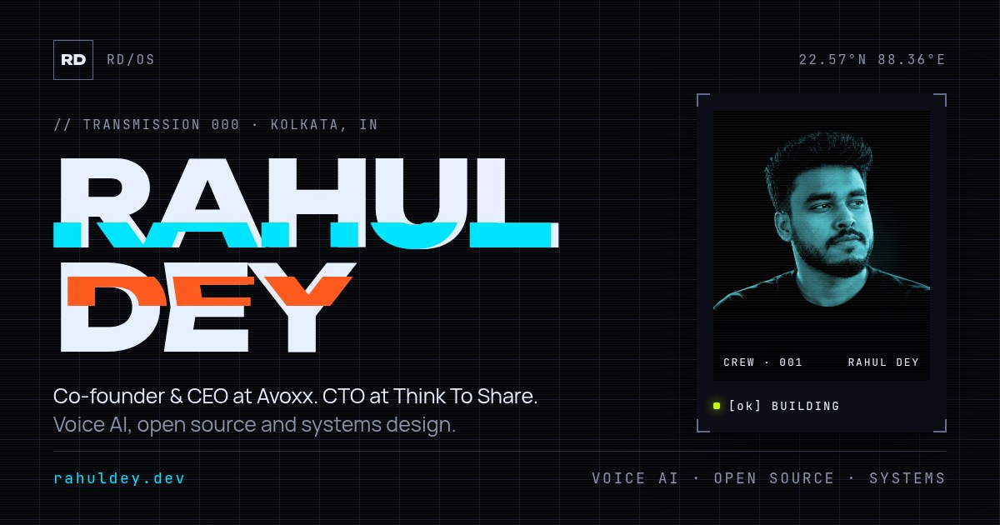
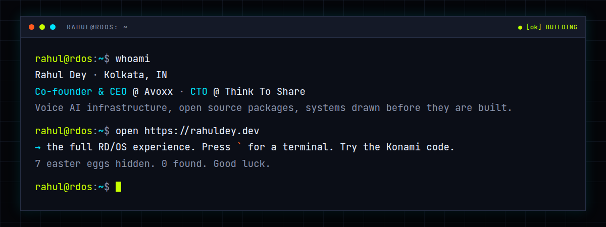
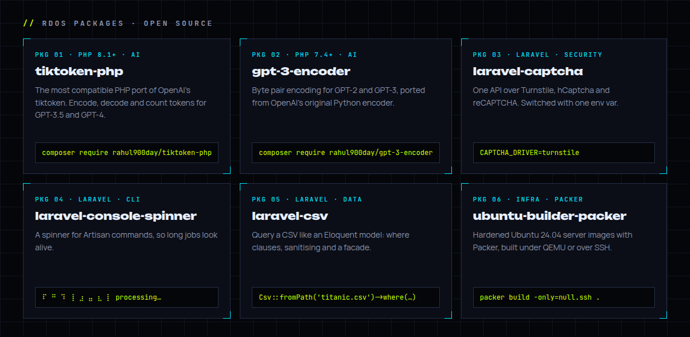

### `rdos now`

- 🎙️ **[Avoxx](https://avoxx.ai)**: voice AI infrastructure
- 🧠 **[Think To Share](https://thinktoshare.com)**: engineering as CTO
- 📦 Maintaining PHP / Laravel open source

[tiktoken-php](https://github.com/RahulDey12/tiktoken-php) · [gpt-3-encoder](https://github.com/RahulDey12/gpt-3-encoder) · [laravel-captcha](https://github.com/RahulDey12/laravel-captcha) · [laravel-console-spinner](https://github.com/RahulDey12/laravel-console-spinner) · [laravel-csv](https://github.com/RahulDey12/laravel-csv) · [ubuntu-builder-packer](https://github.com/RahulDey12/ubuntu-builder-packer)

### `rdos contact`

[rahuldey.dev](https://rahuldey.dev) · [LinkedIn](https://www.linkedin.com/in/rahul900day) · [X](https://twitter.com/Rahul900day) · [♥ Sponsor](https://github.com/sponsors/RahulDey12)
